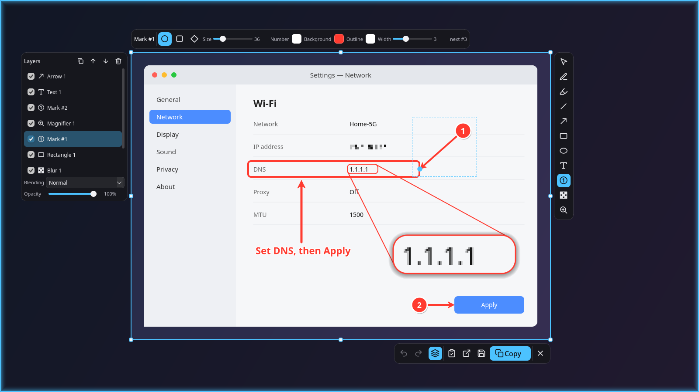

# Kadr

A Wayland screenshot tool built for multi-monitor setups (Hyprland; other wlroots-style
compositors work without window snapping), with Photoshop-like annotation layers and an
editable history. Written in Rust with [egui](https://github.com/emilk/egui); frames are taken
straight from KMS.



## Features

- **Multi-monitor overlay**: every screen freezes and dims; the one under the cursor glows.
  Pick an area, a window (click) or the whole screen (double click / Enter); a pixel loupe
  shows coordinates and color.
- **Tools**: brush, highlighter, line, arrow, rectangle, ellipse, text, blur/pixelate,
  numbered marks (circle/square/diamond; drag a mark away and its arrow stays pinned to the
  original spot) and a magnifier callout with leader lines.
- **Text recognition (OCR)**: press `O` and the selection is recognized locally; the text
  stays invisible over the picture but can be selected with the mouse (drag, double click —
  word, Ctrl+A — all) and copied **as text** with Ctrl+C / Enter / *Copy text*. Prose is copied
  as paragraphs (line breaks and hyphenation inside a paragraph removed), code keeps its lines
  and indentation, side-by-side cells are tab-separated. See [Text recognition](#text-recognition).
- **Layers**: blend modes, opacity, visibility, reordering, multi-select, undo/redo.
- **Editable history**: every shot keeps the full capture plus its layers, so marks, text
  and even the crop can be changed later in the editor.
- **Tray icon**, live clipboard (re-copies the final image after every edit), pinned
  always-on-top shots, 9 interface languages.

## How the screen is captured

Kadr reads the frame that is being scanned out to each monitor directly from KMS (DRM),
the same way `ffmpeg -f kmsgrab` and gpu-screen-recorder do: no compositor protocol is
involved, the frame is frozen the instant you press the key, and the hardware cursor is not
part of it. The buffers are imported into EGL on the GPU that owns them (tiled and
compressed layouts included) and read back.

The kernel hands out scanout buffers only to processes with `CAP_SYS_ADMIN`, so that part
lives in a tiny separate helper, `kadr-kms`: it finds the framebuffer on each lit CRTC's
primary plane, exports it as a dmabuf, passes the descriptor to `kadr` over a socket and
drops the capability. It links no GPU libraries and takes no input. The package grants the
capability in its install hook; for a hand-built copy:

```
sudo setcap cap_sys_admin+ep /path/to/kadr-kms
```

Note that this lets any local user grab the screen through the helper (as with
gsr-kms-server). Without the capability, or when a driver refuses to export a buffer, Kadr
falls back to the `wlr-screencopy` protocol automatically. `KADR_CAPTURE=kms` or
`KADR_CAPTURE=screencopy` forces one backend. With a software cursor (e.g.
`cursor:no_hardware_cursors` on Hyprland) the pointer is drawn into the frame itself and
ends up in KMS captures.

## Text recognition

Recognition runs entirely on your machine, in pure Rust: PaddleOCR's PP-OCR models (a text
line detector plus a recognizer per script, Apache-2.0) on the [rten](https://github.com/robertknight/rten)
inference engine — no Tesseract, no Python, no ONNX Runtime, nothing sent anywhere.

*Automatic* reads every line with both the East-Slavic (Russian, Ukrainian, Belarusian) and the
English recognizers and combines them word by word, so mixed Russian/English text and code
come out right. Other scripts can be picked in the tool's properties bar: European languages
(Latin script), Greek, Chinese/Japanese, Korean, Arabic, Hindi, Thai, Tamil, Telugu. Models not
installed yet are downloaded from Hugging Face on request (pinned revision, SHA-256 checked)
into `~/.local/share/kadr/models`; the package already ships the detector and the default
pair in `/usr/share/kadr/models`.

From the command line:

```
kadr ocr picture.png                 # print the recognized text
kadr ocr --ocr-lang latin pic.png    # another script
kadr ocr --download --ocr-lang greek # fetch models ahead of time
```

## Install (Arch Linux)

Grab `kadr-screenshot-*.pkg.tar.zst` from [Releases](https://github.com/sendement/kadr/releases) and run
`sudo pacman -U kadr-screenshot-*.pkg.tar.zst`, or build it yourself:

```
git clone https://github.com/sendement/kadr && cd kadr/packaging/arch
makepkg -si
```

## Build from source

```
cargo build --release
sudo setcap cap_sys_admin+ep target/release/kadr-kms   # optional, see above
target/release/kadr
```

`kadr` looks for `kadr-kms` next to itself, then in `$PATH`. Every rebuild of `kadr-kms`
drops the capability again. Tests (`cargo test`) drive the real canvas with synthetic input and
render it offscreen on the GPU (needs a `/dev/dri/renderD*` node); their frames land in
`target/shots/`.

The package is named `kadr-screenshot` because the unrelated AUR package `kadr`
(a GTK batch image cropper) would otherwise replace it on AUR-helper upgrades;
both install `/usr/bin/kadr`, so they conflict.

## Usage

```
kadr tray             # tray icon: click — screenshot, middle click — history, right click — menu
kadr                  # select an area (overlay on every screen)
kadr -d 3             # same, after a 3 s delay
kadr screen           # instant shot of the screen under the cursor -> clipboard + history
kadr history          # history gallery
kadr edit [ID|last]   # open a history item in the layer editor
kadr pin [ID|last]    # pin a history item on top of other windows
kadr --lang de ...    # override the interface language for one run
```

Runtime dependencies: libglvnd (EGL/GLES), mesa (libgbm), libxkbcommon, wayland, fontconfig,
a compositor with `wlr-layer-shell`; optional: xdg-desktop-portal (save dialogs), xdg-utils,
a notification daemon. Window snapping, floating editor windows and pins use Hyprland's IPC
socket when it is there.

Data: `~/.local/share/kadr/history/<id>/{base.png,doc.json,result.png,thumb.jpg}`;
settings and remembered tool styles: `~/.config/kadr/config.json`. Both are the same as in
the Python versions (0.1.x), so existing history items and settings carry over.

## Languages

English (default), Русский, Українська, Deutsch, Español, Français, 中文, 日本語, 한국어.
The system language is used automatically (`LANGUAGE` / `LC_ALL` / `LC_MESSAGES` / `LANG`);
unsupported languages fall back to English. Pick one explicitly from the tray menu
(*Language*) or set `"language"` in the config. Translations live in `locales/<code>.json`,
keyed by the English source string, and are compiled into the binary.

## Overlay keys

V pointer · P brush · H highlighter · L line · A arrow · R rectangle · E ellipse · T text ·
M numbered mark · B blur/pixelate · Z magnifier · O text recognition · Tab layers · wheel — tool width/size ·
Shift — 15° steps / square · Ctrl+Z / Ctrl+Shift+Z · Del · Ctrl+D duplicate · Ctrl+[ / ] order ·
arrows — nudge (Shift ×10) · Enter/Ctrl+C copy · Ctrl+S save · Ctrl+E editor · Esc cancel.
Shortcuts follow key positions on non-Latin layouts (Ctrl+Я is Ctrl+Z).

Selecting: drag — area, click — window, double click / Enter — whole screen. With a selection,
a single click outside does nothing, double click outside selects the whole screen, drag
outside starts a new selection.

Marks: click — place; click+drag — place and pull out with an arrow; dragging later moves the
mark while the arrow stays pinned to the original spot (Ctrl+drag moves both).

Magnifier: select the area, drag the copy aside, resize it by its corners; dragging the source
re-targets what is magnified.

## License

MIT, see `LICENSE`. Some icon paths are adapted from Lucide (ISC), see `THIRD_PARTY_NOTICES.md`.
