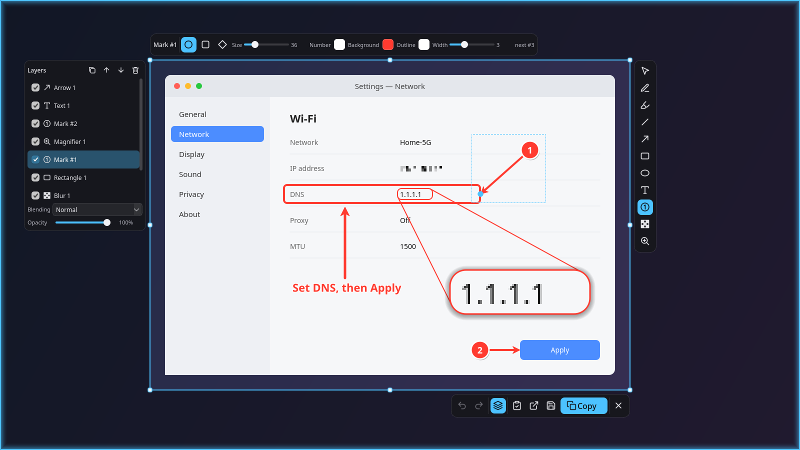

# Kadr

A Wayland screenshot tool built for multi-monitor setups (Hyprland; partially sway),
with Photoshop-like annotation layers and an editable history.



## Features

- **Multi-monitor overlay**: every screen freezes and dims; the one under the cursor glows.
  Pick an area, a window (click) or the whole screen (double click / Enter); a pixel loupe
  shows coordinates and color.
- **Tools**: brush, highlighter, line, arrow, rectangle, ellipse, text, blur/pixelate,
  numbered marks (circle/square/diamond; drag a mark away and its arrow stays pinned to the
  original spot) and a magnifier callout with leader lines.
- **Layers**: blend modes, opacity, visibility, reordering, multi-select, undo/redo.
- **Editable history**: every shot keeps the full capture plus its layers, so marks, text
  and even the crop can be changed later in the editor.
- **Tray icon**, live clipboard (re-copies the final image after every edit), pinned
  always-on-top shots, 9 interface languages.

## Install (Arch Linux)

Grab `kadr-screenshot-*.pkg.tar.zst` from [Releases](https://github.com/sendement/kadr/releases) and run
`sudo pacman -U kadr-screenshot-*.pkg.tar.zst`, or build it yourself:

```
git clone https://github.com/sendement/kadr && cd kadr/packaging/arch
makepkg -si
```

The package is named `kadr-screenshot` because the unrelated AUR package `kadr`
(a GTK batch image cropper) would otherwise replace it on AUR-helper upgrades;
both install `/usr/bin/kadr`, so they conflict.

## Usage

```
kadr tray             # tray icon: click — screenshot, middle click — history, right click — menu
kadr                  # select an area (overlay on every screen)
kadr -d 3             # same, after a 3 s delay
kadr screen           # instant shot of the screen under the cursor -> clipboard + history
kadr history          # history gallery
kadr edit [ID|last]   # open a history item in the layer editor
kadr --lang de ...    # override the interface language for one run
```

Runtime dependencies: pyside6, qt6-svg, qt6-wayland, layer-shell-qt, grim, wl-clipboard;
optional: libnotify, xdg-user-dirs, qt6-translations.

Data: `~/.local/share/kadr/history/<id>/{base.png,doc.json,result.png,thumb.jpg}`;
settings and remembered tool styles: `~/.config/kadr/config.json`.

## Languages

English (default), Русский, Українська, Deutsch, Español, Français, 中文, 日本語, 한국어.
The system language is used automatically (`LANGUAGE` / `LC_ALL` / `LC_MESSAGES` / `LANG`);
unsupported languages fall back to English. Pick one explicitly from the tray menu
(*Language*) or set `"language"` in the config. Translations live in `kadr/locales/<code>.json`,
keyed by the English source string.

## Overlay keys

V pointer · P brush · H highlighter · L line · A arrow · R rectangle · E ellipse · T text ·
M numbered mark · B blur/pixelate · Z magnifier · Tab layers · wheel — tool width/size ·
Shift — 15° steps / square · Ctrl+Z / Ctrl+Shift+Z · Del · Ctrl+D duplicate · Ctrl+[ / ] order ·
arrows — nudge (Shift ×10) · Enter/Ctrl+C copy · Ctrl+S save · Ctrl+E editor · Esc cancel.

Selecting: drag — area, click — window, double click / Enter — whole screen. With a selection,
a single click outside does nothing, double click outside selects the whole screen, drag
outside starts a new selection.

Marks: click — place; click+drag — place and pull out with an arrow; dragging later moves the
mark while the arrow stays pinned to the original spot (Ctrl+drag moves both).

Magnifier: select the area, drag the copy aside, resize it by its corners; dragging the source
re-targets what is magnified.

## License

MIT, see `LICENSE`. Some icon paths are adapted from Lucide (ISC), see `THIRD_PARTY_NOTICES.md`.
